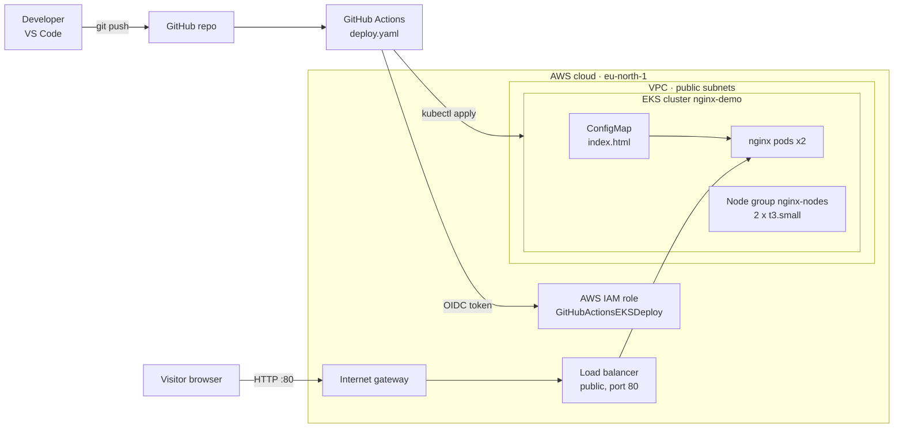
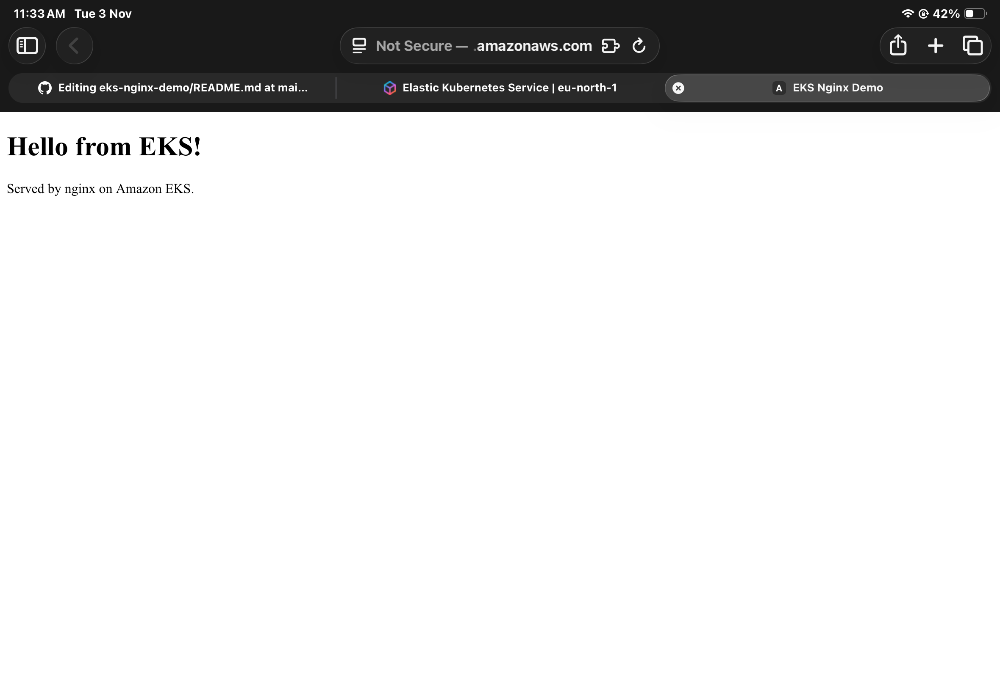
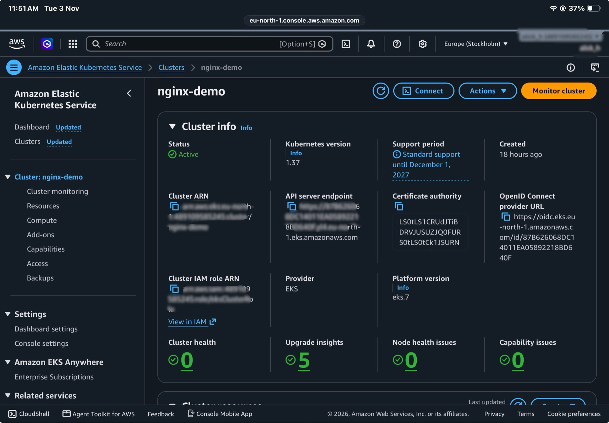
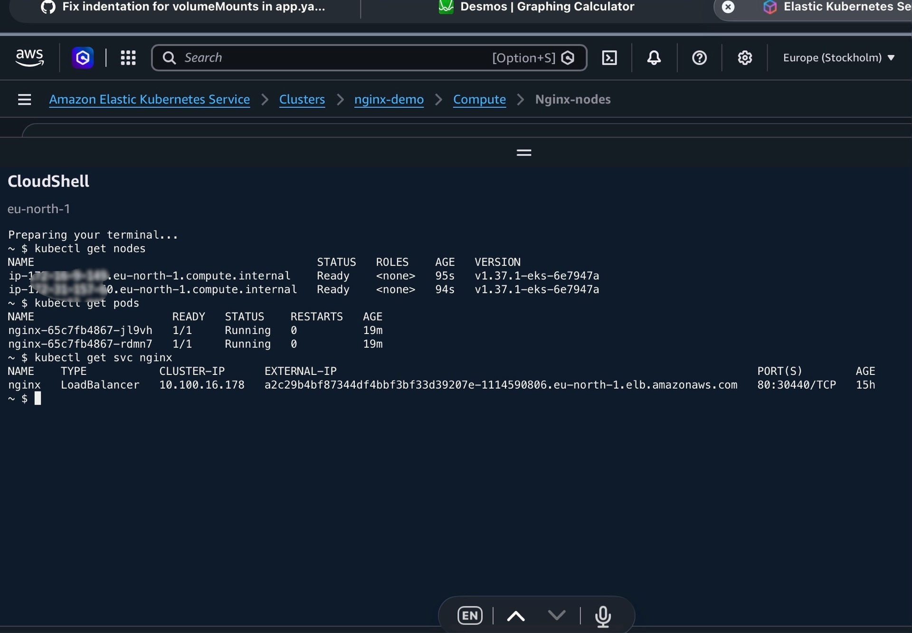
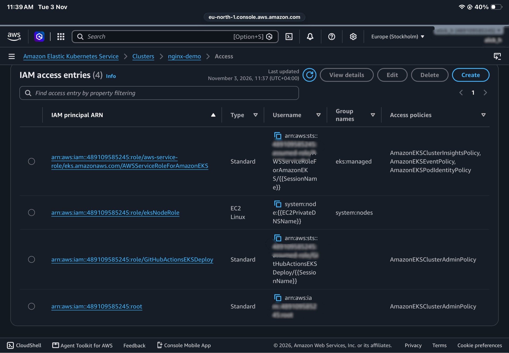
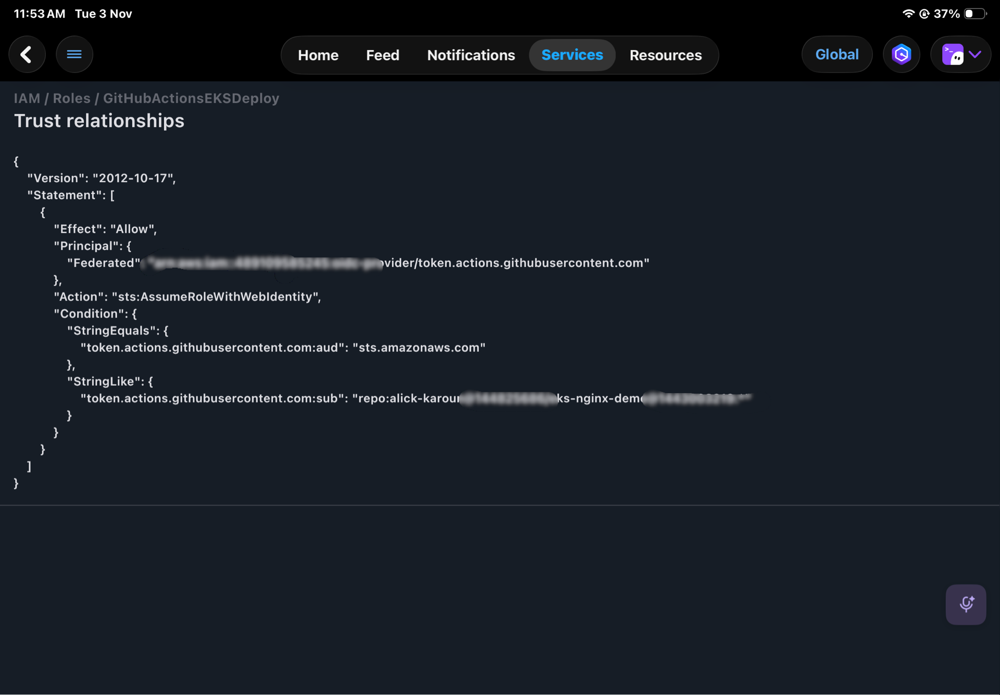

# eks-nginx-demo

*Cluster torn down after the demo to save costs.*

## Architecture

## Screenshots
nginx running on EKS

EKS cluster

nodes

IAM access entries

Roles made for EKS
- `eksClusterRole`: EKS control plane
- `eksNodeRole`: worker nodes
- `GitHubActionsEKSDeploy`: GitHub Actions deploy via OIDC

trust relationship

